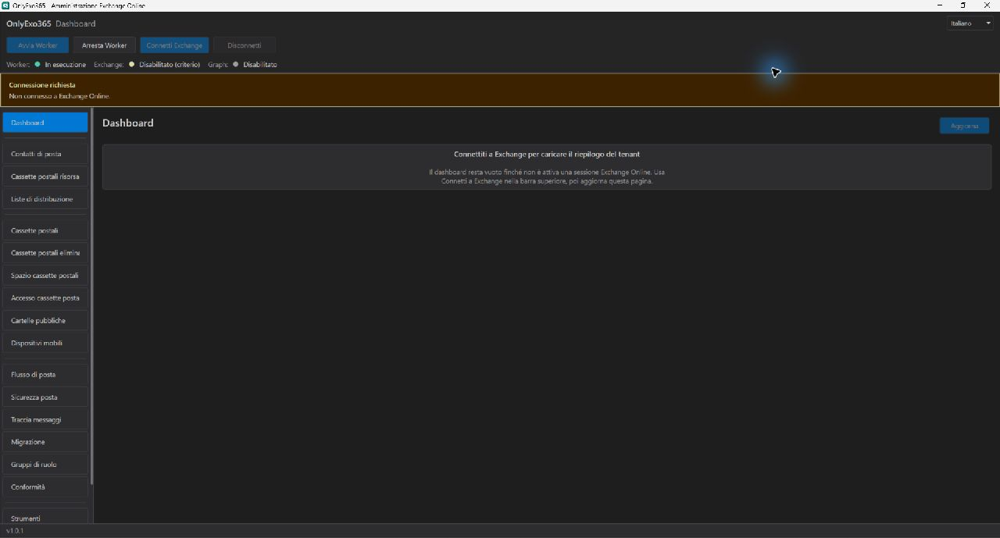
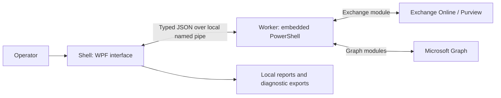

# OnlyExo365

Windows x64 desktop application for administrators and help desks working with Exchange Online and Microsoft Graph. Use a WPF interface to inspect tenant data, edit supported settings and export reports. The interface is available in Italian and English.

## What you can do

| Area | Implemented workflows |
| --- | --- |
| Tenant overview | Mailbox and group counts, license availability and administrative users; partial-data warnings when a section cannot be read |
| Mailboxes | Search and inspect mailboxes; edit settings, automatic replies, delegates and licenses; inspect deleted mailboxes, space and access reports |
| Recipients | Manage mail contacts, resource mailboxes and distribution lists; inspect public folders, mobile devices and migration data |
| Message Trace | Search by date, sender and recipient; page through results, inspect trace details and export the displayed results to XLSX |
| Mail security | Inspect and edit the exposed spam, phishing, malware, quarantine and DKIM settings |
| Mail flow | Edit transport rules, connectors, domains and the exposed address-book and sharing settings; preview the supported subset of rule conditions |
| Compliance | Search audit logs and manage the exposed Purview search, purge and hold actions, subject to authentication, permissions and service capabilities |
| Diagnostics | Check prerequisites, install the approved module versions, show the Worker console and export diagnostic logs |

Feature availability depends on the connected service, tenant permissions and discovered capabilities. See the [operator guide](docs/operations/operator-guide.md) and [visual workflows](docs/operations/visual-guide.md) before applying changes.

## Interface preview



Real application capture: v1.0.1, 1 November 2026, Italian interface, disconnected Dashboard with no tenant data. This scenario shows the interface before sign-in; it does not demonstrate cloud operations. [Capture details](docs/assets/README.md).

## Get started

### Run a supplied package

Obtain an installer or package from the maintainer. To create one from source, follow the [packaging guide](docs/releases/packaging.md).

1. On Windows x64, run the supplied `OnlyExo365.Setup.exe` as administrator, or open `OnlyExo365.Shell.exe` from a supplied extracted package.
2. Framework-dependent packages require the .NET 10 Desktop Runtime; self-contained packages include the runtime.
3. Open **Tools** to check prerequisites. External PowerShell 7.6+ is required for interactive Exchange bootstrap. The approved Exchange and Graph module versions are listed in the [development baseline](docs/development/workflow.md#pinned-baseline).
4. Configure [tenant and authentication settings](docs/configuration/settings.md), then use **Connect Exchange**. Check Worker, Exchange and Graph status separately.

Module installation and cloud operations require network access. Exchange RBAC and Graph consent are specific to the operation; connecting does not grant every action. [Authentication modes and limits](docs/operations/authentication.md).

### Run from source

Install **.NET SDK 10.0.403 exactly** (`global.json` disables roll-forward) and PowerShell 7. Run from the repository root:

```powershell
pwsh ./scripts/bootstrap.ps1 -RuntimeIdentifier win-x64
pwsh ./scripts/build.ps1 -Configuration Debug -RuntimeIdentifier win-x64 -Clean:$false -LockedMode
pwsh ./scripts/start.ps1 -Configuration Debug -RuntimeIdentifier win-x64 -NoBuild
```

`-Clean:$false` preserves existing build outputs. The repository scripts write generated files under `artifacts/`; use the [development workflow](docs/development/workflow.md) for validation and packaging commands. Running from source has the same tenant and module requirements as a supplied package.

## How it works



Shell handles presentation and supervises a separate Worker process. Worker executes PowerShell; Contracts supplies the shared messages, DTOs and module policy. The local pipe authenticates its session and bounds message size. See [architecture](docs/architecture/overview.md) and [IPC](docs/architecture/ipc.md).

## Limits and data handling

- **OnlyExo365 does not automatically retry cloud writes.** A timeout or partial failure can leave a change applied remotely. Refresh and inspect the tenant state before submitting it again; there is no automatic rollback. Vendor modules can have their own retry behavior.
- **Message Trace** accepts an interval of at most 10 days within the last 90 days. Counts remain partial while more pages are available.
- **Rule Test** evaluates a subset of conditions and can return an indeterminate result. It does not simulate Exchange delivery or rule actions.
- **Compliance/eDiscovery** has separate session and authentication constraints. Device code and managed identity are unsupported for the application's Compliance connection; app-only eDiscovery is rejected.
- **Local data persists.** Reports, logs, preferences and the license catalog use the locations described in [local storage](docs/configuration/storage.md). Diagnostic exports can contain tenant identifiers and service messages; review them before sharing.
- Offline tests and the disconnected screenshot do not qualify real tenant authentication, installer behavior, DPI, accessibility or populated-grid performance. See [qualification](docs/development/qualification.md). Audit reports describe their recorded revisions.

## Documentation and assistance

| Need | Guide |
| --- | --- |
| First connection and everyday tasks | [Operator guide](docs/operations/operator-guide.md), [visual workflows](docs/operations/visual-guide.md) |
| Tenant settings and module policy | [Configuration](docs/configuration/settings.md), [authentication](docs/operations/authentication.md) |
| Errors, logs and Worker console | [Diagnostics](docs/operations/diagnostics.md), [local storage](docs/configuration/storage.md) |
| Build, test and package | [Development workflow](docs/development/workflow.md), [packaging](docs/releases/packaging.md), [signing](docs/releases/signing.md) |
| Components and protocol | [Architecture](docs/architecture/overview.md), [IPC](docs/architecture/ipc.md) |
| All guides and historical audits | [Documentation index](docs/README.md) |

For a problem, start with Diagnostics and contact the maintainer through the channel that supplied your package. Include the application version, page, authentication mode and steps to reproduce. Review logs and remove secrets and tenant data before sending evidence. No support SLA is declared here.

Proprietary software, copyright © 2026 Danny Perondi. Use, modification and distribution are governed by [LICENSE](LICENSE).
