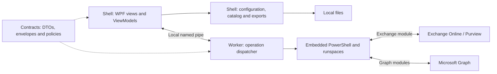
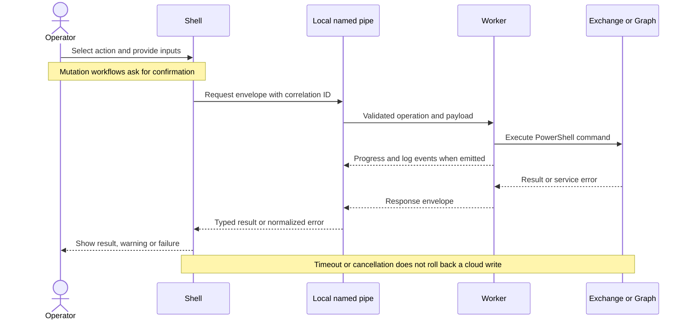

# Architecture

| Project | Responsibility |
| --- | --- |
| Shell (`net10.0-windows`) | WPF views/ViewModels, localization, configuration, local SKU cache, Worker supervision |
| Worker (`net10.0`) | Embedded PowerShell, Exchange/Graph runspaces, command mapping, capability detection and error classification |
| Contracts (`net10.0`) | IPC envelopes, DTOs, configuration, module policy, protected secret references and persistent logs |
| Tests (`net10.0-windows`) | Unit, generated-command, local-pipe, script and offscreen WPF regressions |

These responsibilities are folders and types inside the existing projects, not separate Domain/Application/Infrastructure assemblies. Shell `Bootstrap` composes pages and services; `UseCases` coordinates connection; Worker `Operations` dispatches requests into `PowerShell` modules. The 18 page ViewModels are constructed eagerly and retain application lifetime. The isolated bootstrap fixture took 152–157 ms for its first case and 4–21 ms for later cases in two local runs, including JIT, fixture setup and assertions. That proxy does not establish a full application startup bottleneck, so page lifetime/navigation semantics remain unchanged. Real startup profiling is part of UX-08; see the [local remediation log](../audits/2026-10-11-local-remediation.md).

The two processes communicate through [IPC](ipc.md). Catalog refresh runs inside Shell without IPC. The [module policy](../../src/OnlyExo365.Contracts/Data/PowerShellModuleBootstrapPolicy.json) is embedded in Contracts and shared by both hosts and tenant validation.

## Components and data paths

This describes the existing process and project boundaries. Shell's catalog download is a separate network path; Exchange/Graph administrative commands run in Worker.

## Request lifecycle

Cancellation and deadlines bound local request handling; they do not prove that a remote mutation was undone. The application resilience pipeline retries selected read operations only; it does not control retries internal to vendor modules. See [IPC](ipc.md) for framing, cancellation and message limits.

## Runtime decision

Retain .NET 10, an exact SDK pin with roll-forward disabled, and an embedded PowerShell SDK in the separate Worker to keep PowerShell execution outside WPF. Packaging targets `win-x64`; the current pinned versions are listed once in [workflow](../development/workflow.md). Dependency revisions and their evidence belong to the [critical audit](../audits/2026-10-10-critical-audit.md).

`scripts/` contains public entrypoints; `scripts/internal/common.ps1` provides shared helpers; `build/` implements gates, packaging and validation; `installer/OnlyExo365.iss` defines installation. Hotspot constraints are enforced by `build/assert-architecture-constraints.ps1`.
