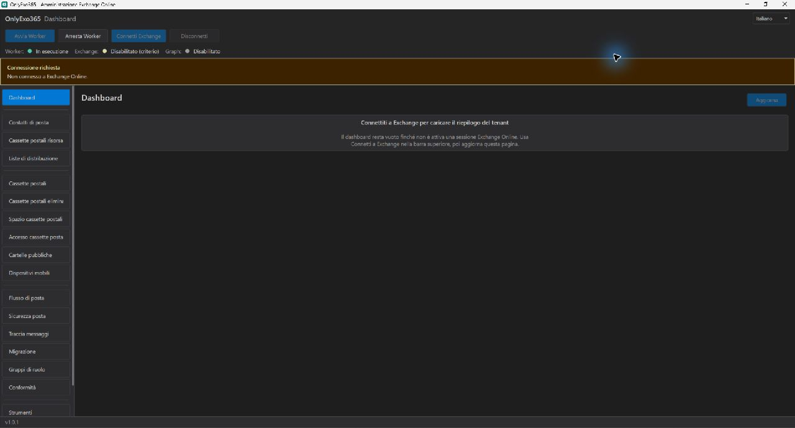

# Public interface assets

## Disconnected Dashboard

| Field | Value |
| --- | --- |
| Application | OnlyExo365 WPF Shell v1.0.1 |
| Source revision | `d7889836c000ec279dc439baffc1fe68ec6fb08e`; documentation and pre-existing instruction edits in working tree, application source unchanged |
| Captured | 1 November 2026, Windows x64, Release build with SDK 10.0.403 |
| Scenario | Italian Dashboard; Worker running; Exchange disabled for the launched process with `ONLYEXO365_DISABLE_EXO=1`; no sign-in or tenant records |
| Capture | computer-use `@oai/sky`, Windows.Graphics.Capture; returned JPEG converted to PNG without cropping or changing UI content |
| Image | 1280 × 689; public copy has unnecessary PNG metadata removed |

Reproduction: build the revision, set `ONLYEXO365_DISABLE_EXO=1` for the application process, launch Shell, activate and maximize its window, and capture Dashboard before signing in. Originals, hashes and review records are retained outside the product repository.

The image illustrates this disconnected state only. It does not qualify cloud operations, connected grids, accessibility or other DPI settings. The older images under `screenshots/` are retained historical assets; the current README uses the capture documented here.
