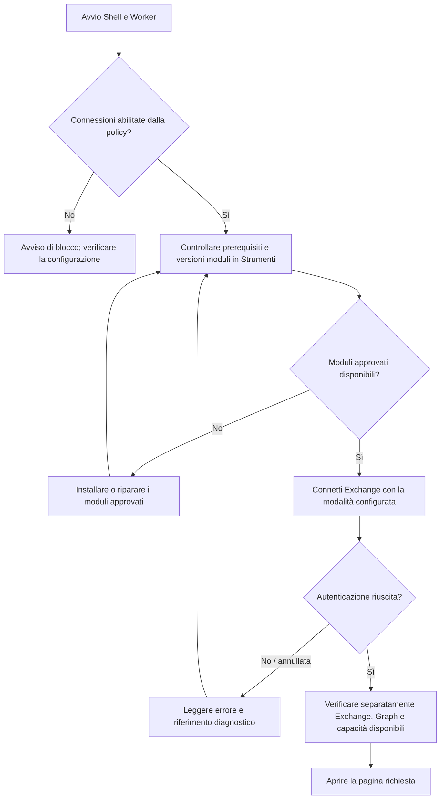
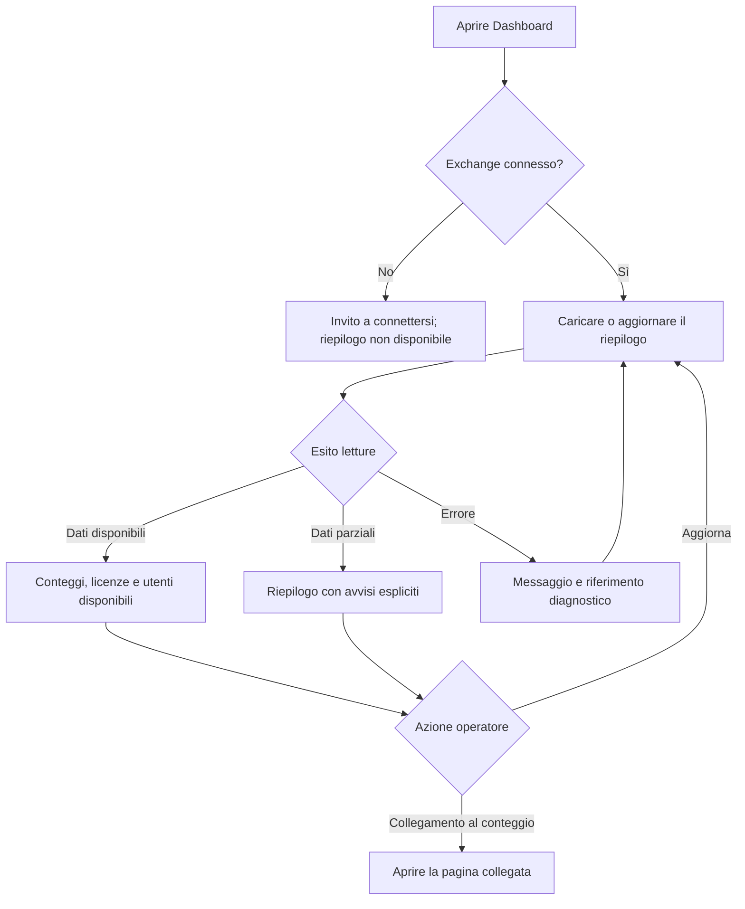
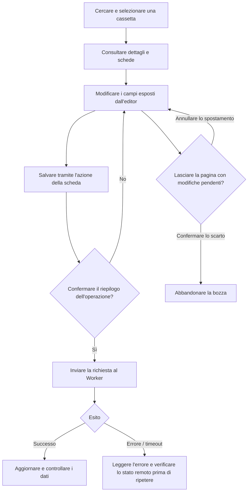
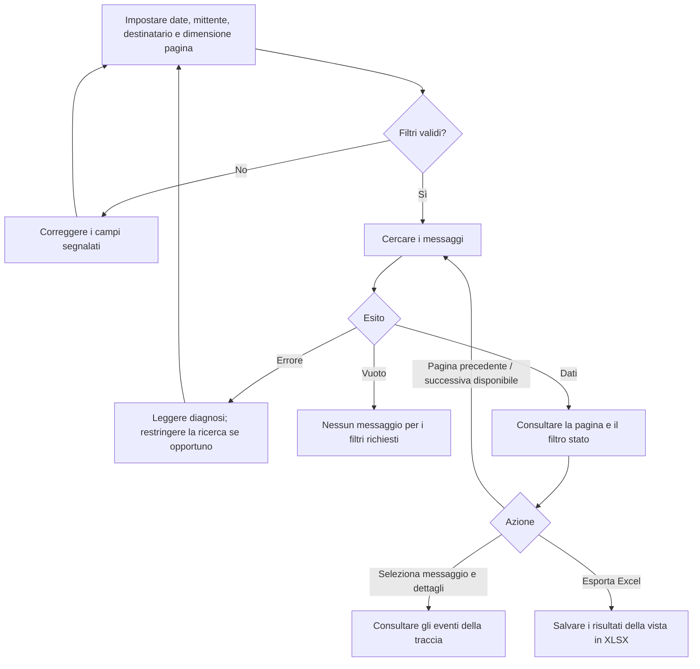
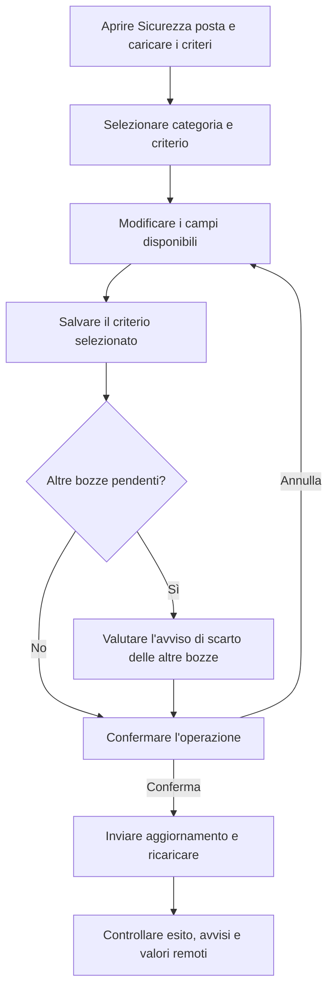
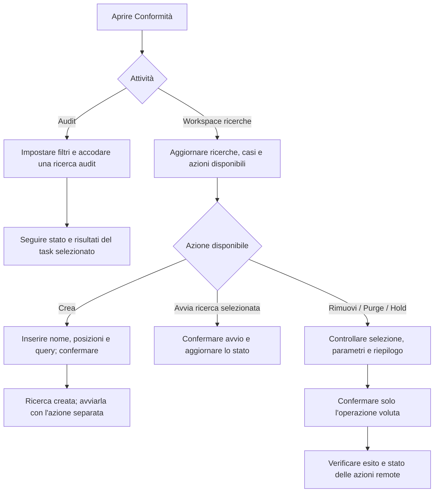
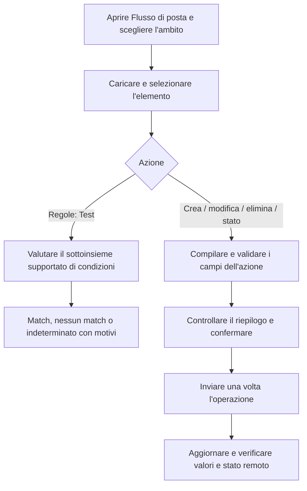
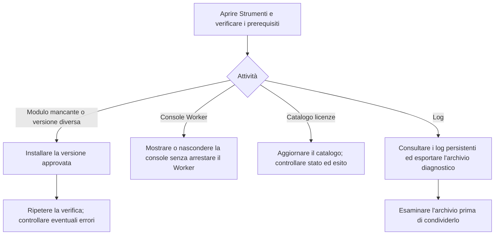

# Guida visiva ai percorsi utente

Percorsi per amministratori Exchange Online e help desk, ricavati da viste, ViewModel e comandi Worker. I diagrammi descrivono il comportamento implementato; le operazioni reali richiedono permessi e qualifica nel tenant di destinazione. Le etichette sono descrittive e possono differire tra UI italiana e inglese.

## Indice

1. [Connessione](#1-connessione)
2. [Dashboard](#2-dashboard)
3. [Cassette postali](#3-cassette-postali)
4. [Tracciamento messaggi](#4-tracciamento-messaggi)
5. [Sicurezza posta](#5-sicurezza-posta)
6. [Conformità](#6-conformità)
7. [Flusso di posta](#7-flusso-di-posta)
8. [Strumenti e diagnostica](#8-strumenti-e-diagnostica)

## 1. Connessione

Avviare il Worker e controllare i prerequisiti in Strumenti. Le versioni approvate dei moduli devono essere disponibili prima della connessione; una versione più recente non sostituisce quella richiesta. La modalità di autenticazione si configura tramite [impostazioni](../configuration/settings.md).

Il Worker in esecuzione non prova l'accesso a Exchange. Graph può avere uno stato diverso; Compliance apre sessioni separate. Per le quattro modalità e i rispettivi limiti consultare [autenticazione](authentication.md).

Fonti: [stato connessione](../../src/OnlyExo365.Shell/ViewModels/ShellConnectionStateViewModel.cs), [bootstrap interattivo](../../src/OnlyExo365.Shell/Services/InteractiveExchangeBootstrapService.cs), [policy moduli](../../src/OnlyExo365.Contracts/Data/PowerShellModuleBootstrapPolicy.json).

## 2. Dashboard

La Dashboard mostra conteggi di cassette e gruppi, licenze e utenti amministrativi quando disponibili. Non è un monitor generale della salute dei servizi Microsoft 365.

La cache è limitata alla sessione; cambi di connessione invalidano i valori. Un elenco vuoto e una lettura fallita hanno significati diversi.

Fonti: [DashboardView](../../src/OnlyExo365.Shell/Views/DashboardView.xaml), [DashboardViewModel](../../src/OnlyExo365.Shell/ViewModels/DashboardViewModel.cs).

## 3. Cassette postali

Cercare una cassetta, selezionarla e aprire i dettagli. Impostazioni, risposte automatiche, deleghe e licenze hanno azioni specifiche; le scritture di licenze richiedono anche Graph e il relativo consenso.

L'avviso di navigazione permette di confermare lo scarto o restare: non offre un salvataggio universale di tutte le schede. Un salvataggio può comprendere più operazioni; il fallimento di una fase non annulla quelle già eseguite.

Fonti: [dettagli](../../src/OnlyExo365.Shell/ViewModels/MailboxDetailsViewModel.cs), [editor permessi](../../src/OnlyExo365.Shell/ViewModels/MailboxPermissionsEditorViewModel.cs), [licenze](../../src/OnlyExo365.Shell/ViewModels/MailboxLicensesViewModel.cs).

## 4. Tracciamento messaggi

Impostare inizio e fine in ordine crescente: massimo 10 giorni negli ultimi 90, senza date future. I risultati possono essere paginati e filtrati per stato. L'export usa i risultati presenti nella vista, senza scaricare automaticamente tutta la ricerca.

I conteggi restano parziali finché esistono altre pagine. Il Worker usa una pagina di lookahead per determinare `HasMore`; non equivale a conoscere il totale del tenant.

Fonti: [ViewModel](../../src/OnlyExo365.Shell/ViewModels/MessageTraceViewModel.cs), [comandi Worker](../../src/OnlyExo365.Worker/PowerShell/ExoMessageTraceCommands.cs).

## 5. Sicurezza posta

Le categorie esposte sono spam in entrata/uscita, phishing, malware, quarantena e DKIM. Disponibilità e modifiche ammesse dipendono dalle capacità della sessione.

Conservare le modifiche utili prima di accettare lo scarto di altre bozze. Nessun diagramma garantisce l'efficacia di un criterio di protezione sul tenant.

Fonte: [MailSecurityViewModel](../../src/OnlyExo365.Shell/ViewModels/MailSecurityViewModel.cs).

## 6. Conformità

Audit e ricerche hanno requisiti distinti. eDiscovery richiede la connessione di ricerca interattiva delegata supportata dall'applicazione. La creazione di una ricerca e il suo avvio sono azioni separate.

Purge espone `SoftDelete` e `HardDelete`: non descrive ogni richiesta come eliminazione definitiva. Un hold richiede il caso e i parametri previsti; la risposta di un comando non certifica conservazione legale o conformità normativa. L'elenco hold può essere segnalato come non supportato.

Fonti: [ComplianceViewModel](../../src/OnlyExo365.Shell/ViewModels/ComplianceViewModel.cs), [coda audit](../../src/OnlyExo365.Shell/ViewModels/ComplianceViewModel.AuditQueue.cs), [autenticazione](authentication.md).

## 7. Flusso di posta

La pagina raggruppa regole, connettori, domini accettati/remoti, relazioni organizzative, criteri di condivisione, elenchi indirizzi, rubriche offline e criteri rubrica. Il salvataggio riguarda i campi esposti dall'editor.

Per le regole, svuotare un campo esposto può rimuoverne il valore remoto. Aggiornamento e abilitazione/disabilitazione sono comandi separati: può riuscire il primo e fallire il secondo. Il Test non simula consegna o azioni Exchange. Vedere i dettagli nella [guida operatore](operator-guide.md#mail-flow-editing).

Fonti: [MailFlowViewModel](../../src/OnlyExo365.Shell/ViewModels/MailFlowViewModel.cs), [regole](../../src/OnlyExo365.Shell/ViewModels/MailFlowRulesViewModel.cs), [comandi](../../src/OnlyExo365.Worker/PowerShell/ExoTransportRuleCommands.cs).

## 8. Strumenti e diagnostica

Strumenti resta disponibile per la riparazione dei prerequisiti anche quando una connessione al tenant fallisce. Il controllo dei componenti non dimostra che tutte le operazioni siano autorizzate.

I log possono contenere identificatori del tenant e messaggi del servizio. Consultare [diagnostica](diagnostics.md), [archiviazione](../configuration/storage.md) e [catalogo licenze](../licensing/catalog.md).

Fonti: [ToolsViewModel](../../src/OnlyExo365.Shell/ViewModels/ToolsViewModel.cs), [LogsViewModel](../../src/OnlyExo365.Shell/ViewModels/LogsViewModel.cs).
