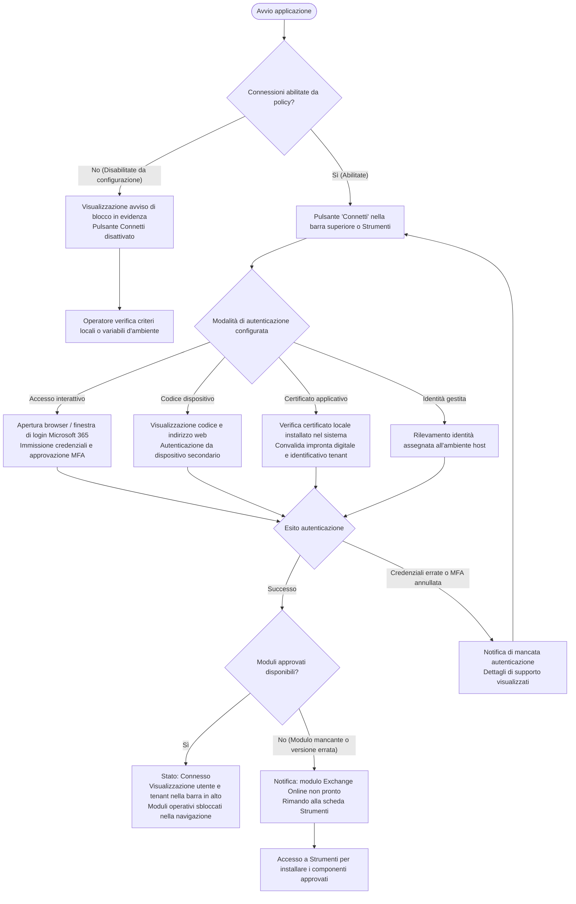
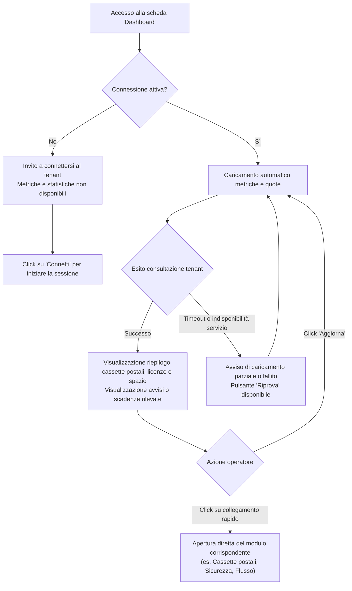
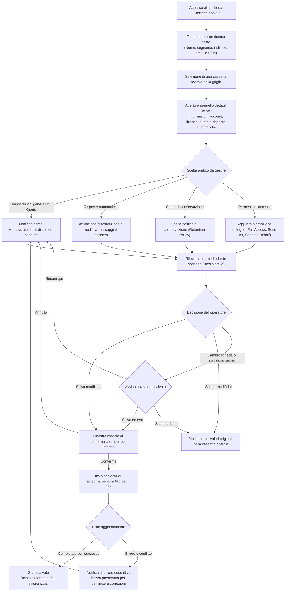
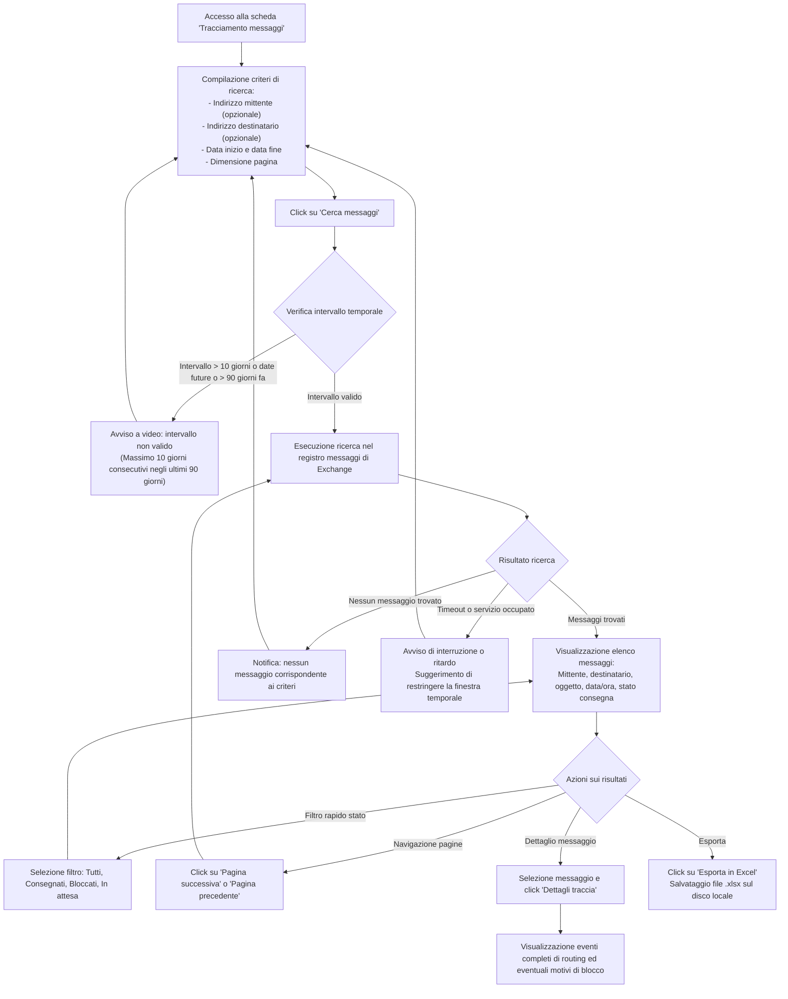
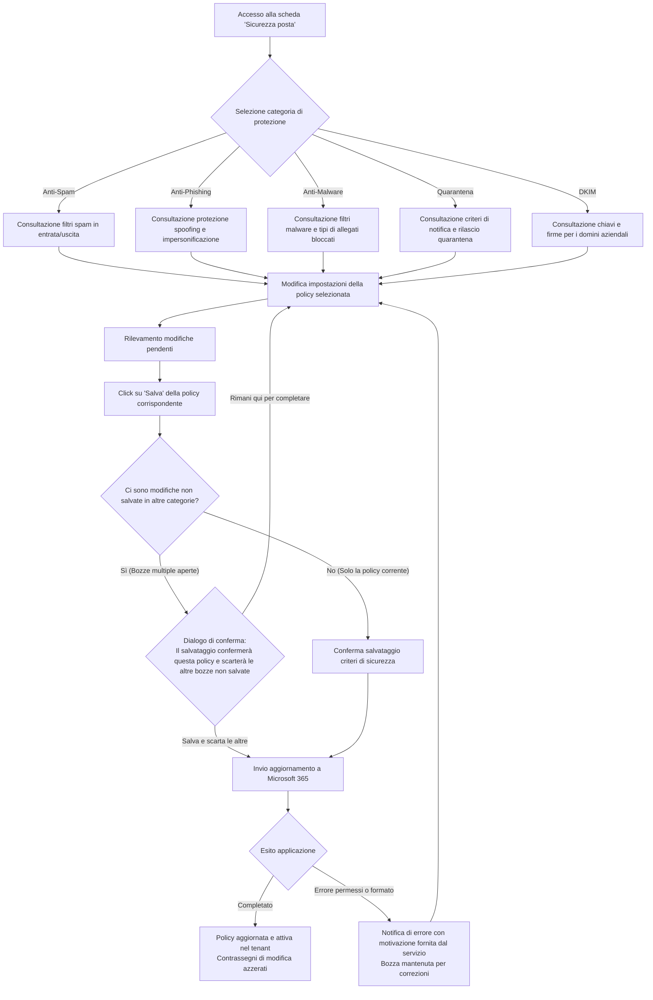
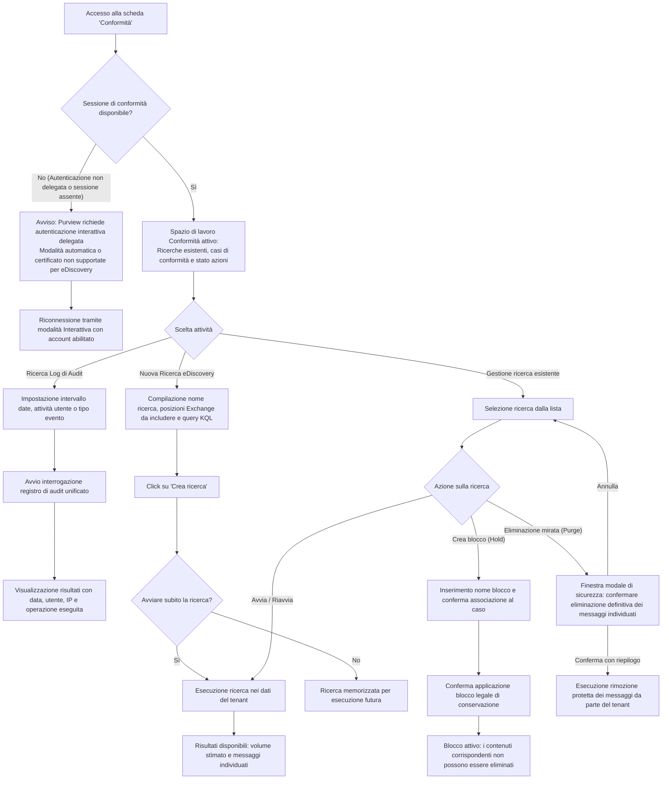
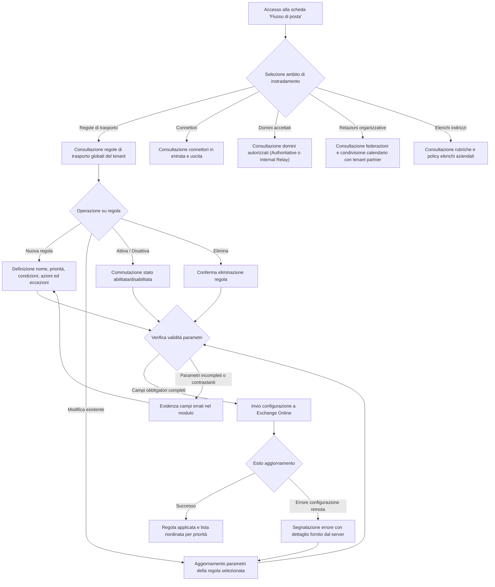
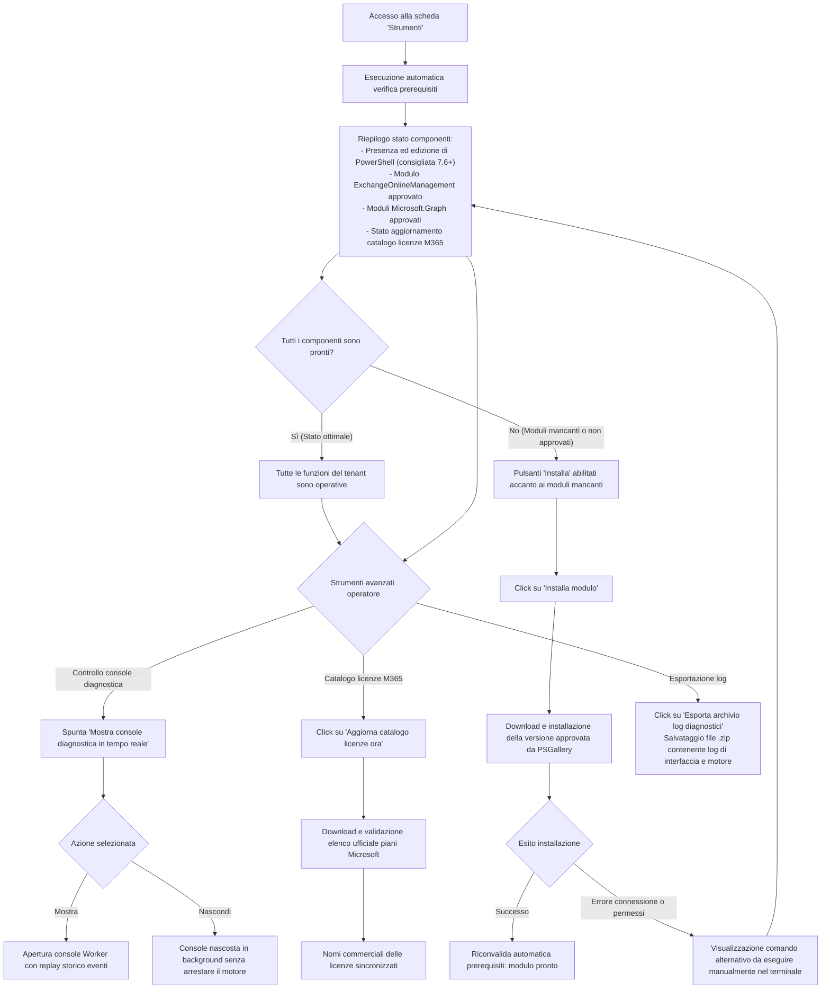

# Guida visiva ai percorsi utente

Questa guida illustra i flussi operativi dell'applicazione attraverso diagrammi visivi dedicati per ciascuna funzionalità principale. Ogni percorso evidenzia il punto di ingresso dell'utente, le azioni disponibili, le scelte decisionali, i risultati previsti e le procedure di recupero in caso di errore.

---

## Indice dei percorsi

1. [Connessione e Autenticazione al Tenant](#1-connessione-e-autenticazione-al-tenant)
2. [Dashboard e Panoramica Generale](#2-dashboard-e-panoramica-generale)
3. [Gestione Cassette Postali e Dettagli Utente](#3-gestione-cassette-postali-e-dettagli-utente)
4. [Tracciamento dei Messaggi (Message Trace)](#4-tracciamento-dei-messaggi-message-trace)
5. [Politiche di Sicurezza della Posta (Mail Security)](#5-politiche-di-sicurezza-della-posta-mail-security)
6. [Conformità e Ricerca Purview (Compliance & eDiscovery)](#6-conformit%C3%A0-e-ricerca-purview-compliance--ediscovery)
7. [Regole e Flusso di Posta (Mail Flow)](#7-regole-e-flusso-di-posta-mail-flow)
8. [Strumenti, Prerequisiti e Diagnostica (Tools)](#8-strumenti-prerequisiti-e-diagnostica-tools)

---

## 1. Connessione e Autenticazione al Tenant

Il percorso iniziale permette all'operatore di autenticarsi verso il tenant Microsoft 365, inizializzare il motore di gestione e sbloccare le funzionalità dell'applicazione.

---

## 2. Dashboard e Panoramica Generale

Pannello di controllo che sintetizza le informazioni chiave del tenant e offre accessi rapidi alle sezioni operative.

---

## 3. Gestione Cassette Postali e Dettagli Utente

Ricerca, ispezione delle impostazioni e modifica protetta delle proprietà delle cassette postali con salvaguardia delle bozze non salvate.

---

## 4. Tracciamento dei Messaggi (Message Trace)

Strumento per localizzare messaggi di posta, verificare lo stato di consegna e diagnosticare problemi di recapito.

---

## 5. Politiche di Sicurezza della Posta (Mail Security)

Gestione delle difese perimetrali di Exchange Online: criteri anti-spam, anti-phishing, anti-malware, quarantena e chiavi DKIM.

---

## 6. Conformità e Ricerca Purview (Compliance & eDiscovery)

Gestione delle ricerche di conformità legale, analisi dei log di audit unificati e applicazione di blocchi protettivi (Hold).

---

## 7. Regole e Flusso di Posta (Mail Flow)

Configurazione dell'infrastruttura di routing messaggi: regole di trasporto globali, connettori aziendali, domini accettati e relazioni organizzative.

---

## 8. Strumenti, Prerequisiti e Diagnostica (Tools)

Pannello tecnico per la verifica dell'ambiente di esecuzione, l'installazione dei moduli ufficiali necessari, il monitoraggio diagnostico e l'aggiornamento del catalogo licenze.

